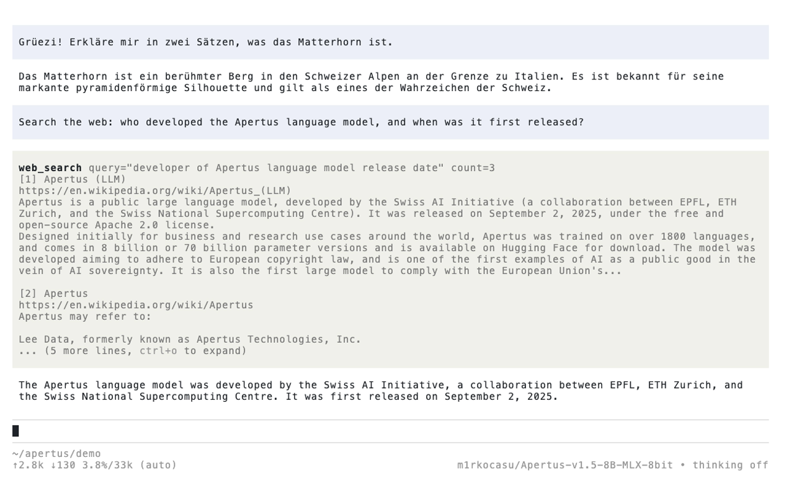

# 7. Demo: chat and a web search tool call with Pi in herdr

Status: **recorded on 2026-11-20**.

Video: [`demo/apertus-pi-demo.mp4`](../demo/apertus-pi-demo.mp4) (36 seconds, 1280x764). Final frame:

## What it shows

1. Pi running in a herdr pane, with Apertus 1.5 8B as the model and thinking off.
2. A chat turn in German: "Grüezi! Erkläre mir in zwei Sätzen, was das Matterhorn ist."
3. A tool turn: "Search the web: who developed the Apertus language model, and when was it first released?" The model calls `web_search`, the tool returns the Wikipedia article on Apertus, and the model answers from it.

## The web_search tool

Pi has no built-in web search. [`pi/extensions/web-search.ts`](../pi/extensions/web-search.ts) adds one; copy it to `~/.pi/agent/extensions/`.

- With `BRAVE_API_KEY` set, it uses the Brave Search API (general web search). This path is written but **not tested**, since no key is configured.
- Without a key, it searches Wikipedia through the public MediaWiki API. **The demo uses this path**, so "web search" here means Wikipedia only.
- Scraping DuckDuckGo was tried and dropped: it answers automated requests with a CAPTCHA after a few queries.
- Wikipedia search needs every query word to match. The model tends to send whole questions, which returned unrelated pages, so the tool strips question and filler words before searching.

## How the video was made

It is assembled from screenshots of the pane, not a screen recording.

1. A herdr tab with one 120x40 pane was created and Pi started in it:
   `herdr agent start apertus-demo --kind pi --pane <pane> -- --tools web_search --thinking off --no-session`
2. [`demo/capture.sh`](../demo/capture.sh) types the two prompts into the pane with `herdr pane send-text`, waits for the agent with `herdr agent wait`, and meanwhile saves the pane content as ANSI text about every 0.4 seconds (`herdr pane read --format ansi`). This gave 80 frames, 43 of them distinct.
3. Each distinct frame was replayed in a [vhs](https://github.com/charmbracelet/vhs) terminal with [`demo/show.sh`](../demo/show.sh) and saved with vhs's `Screenshot` command, using a light theme to match the terminal Pi was running in.
4. `ffmpeg` joined the screenshots, holding each one for as long as it was on screen.

Consequences of this method: the video shows the pane content only, not the herdr sidebar and tab bar, and the timing is approximate.

## What it took to get a clean take

- The first take failed. The model sent the whole question as the query, got unrelated results, and then wrote its retry in Apertus's native tool format (`<|tools_prefix|>[…]`), which the server does not parse, so the call appeared as text. The filler-word stripping above fixed the first step; the second weakness remains.
- With only `web_search` enabled, the model called it even for a plain greeting in one test. The chat prompt in the demo is a knowledge question the model answers directly.
- With thinking set to medium, one of the test runs ended with a tool call printed as text instead of an answer. The demo runs with thinking off.
